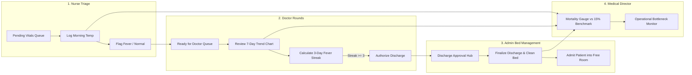

# BioGuard 74 — Virus Quarantine & Treatment Facility Management App

BioGuard 74 is an operational and clinical management system built for a 74-bed viral quarantine and treatment facility. It resolves daily shift hand-off bottlenecks between nurses, doctors, and administrative staff, enforces the strict 3-day fever-free discharge protocol, and continuously tracks facility mortality against the 15% quality benchmark.

---

## 🚀 Quick Start & Deployment Options

### Option 1: Instant Local Execution (Zero-Dependency)
The application is entirely self-contained (HTML5, Tailwind CSS via CDN, Chart.js via CDN, pure modern ES6). Run from the project directory:

```bash
cd "C:\Users\ndpat\.gemini\antigravity\scratch\quarantine-facility-app"
python -m http.server 3000
```
Then open [http://localhost:3000](http://localhost:3000) in any web browser.

### Option 2: Deploy to Vercel (Zero-Config)
The repository includes pre-configured `vercel.json` and `package.json`:
1. Push this directory to a GitHub repository or drag-and-drop into [Vercel Dashboard](https://vercel.com/new).
2. Or run via the Vercel CLI:
   ```bash
   npm i -g vercel
   vercel deploy --prod
   ```
3. Vercel automatically detects the static assets and provides an instant live HTTPS link.

### Option 3: Deploy to Netlify or GitHub Pages
- **Netlify**: Drag and drop the `quarantine-facility-app` directory into [app.netlify.com/drop](https://app.netlify.com/drop) for an instant live URL.
- **GitHub Pages**: Push to GitHub, go to **Settings** > **Pages** > Select `main` branch root > Save.

---

## 📋 Comprehensive Responses to Leadership Questions

---

### Q1: App User Types & Role-Based Feature Matrix (V1)

In Version 1, the app establishes four distinct user personas to eradicate the lack of cross-shift visibility and disorganized daily routines:



#### 1. Nurse (Vitals & Triage)
- **Primary Responsibility**: Measure and document once-daily morning temperatures for all 74 quarantine patients without duplicate trips or omitted rooms.
- **Key Features & Actions**:
  - **"Pending Vitals" Worklist**: Default queue filtered to patients awaiting morning temperature.
  - **Quick Vitals Modal**: Fast entry with Celsius (°C) and Fahrenheit (°F) auto-conversion, symptom toggles (shivering, persistent cough, dyspnea, fatigue), and clinical observation notes.
  - **Fever Classification Badging**: Real-time evaluation (<37.5°C Normal [Green], 37.5–37.9°C Low-Grade [Amber], ≥38.0°C High Fever [Red]).
  - **Duplicate Entry Protection**: Warns the nurse if a reading was already taken today, requiring confirmation for re-checks or corrections.
  - **Automatic State Transition**: Saving vitals automatically updates patient status to `Ready for Doctor Review`.

#### 2. Doctor (Attending Physician)
- **Primary Responsibility**: Review vitals, conduct daily bedside rounds, evaluate 7-day temperature trajectory, update medication/treatment regimens, and authorize discharge upon meeting the 3-day fever-free criterion.
- **Key Features & Actions**:
  - **"Ready for Doctor" Priority Queue**: Highlights patients whose vitals have already been recorded today, preventing premature or wasted doctor rounds.
  - **Unmeasured Vitals Warning**: If a doctor opens an unmeasured patient, a clear operational warning appears with a one-click option to take the temperature directly.
  - **3-Day Fever-Free Streak Tracker**: Visual progress pill (`Day 1/3`, `Day 2/3`, `Day 3/3 - Cured!`).
  - **Interactive Clinical Trajectory Chart**: 7-day interactive line graph with a red dashed line at the 38.0°C fever threshold.
  - **Discharge Authorization Button**: Unlocked strictly when 3 consecutive fever-free days are achieved, instantly transmitting a discharge directive to Admin staff.
  - **Adverse Outcome Recording**: Dedicated option to declare a patient deceased with primary clinical cause, immediately updating the facility mortality statistics.

#### 3. Admin Staff (Bed Manager & Patient Registrar)
- **Primary Responsibility**: Coordinate admissions, maximize bed turnover across all 74 rooms, and eliminate the 1–2 day post-recovery stay delay.
- **Key Features & Actions**:
  - **74-Bed Live Interactive Matrix**: Visual grid representing Room 1 through Room 74 with color-coded status tiles (Occupied, Discharge Approved, High Fever, Clean/Available).
  - **Discharge Action Center**: Queue of doctor-approved discharges. One click finalizes departure, archives the patient, and releases the bed.
  - **Patient Intake / Admission**: Form to admit waiting patients into newly available rooms. Hard-disabled when facility is at 74/74 full occupancy.

#### 4. Facility Medical Director (Quality & Governance)
- **Primary Responsibility**: Monitor treatment efficacy against the 15% mortality benchmark, detect shift delays, and maintain clinical compliance.
- **Key Features & Actions**:
  - **Mortality Benchmark Monitor**: Real-time calculation against the 15.0% expected mortality benchmark.
  - **Automatic Critical Alert**: If mortality rises above 15.0%, a red alert banner triggers across the facility dashboard recommending clinical review.
  - **Cure Rate Metric**: Discharged cured percentage vs. 85.0% success target.
  - **Shift Bottleneck Diagnostic**: Live counters tracking unmeasured patients past morning hours, doctor round delays, and discharge lag.

---

### Q2: Functional Prototype Features & Screen Architecture

The delivered prototype (`quarantine-facility-app`) contains all necessary operational screens and functional workflows:

1. **Top Operations Strip**:
   - Live metrics: Bed Occupancy (74/74), Today's Vitals logged, Doctor rounds completed, 3-Day Fever-Free patients ready for discharge, and live Mortality Rate.
   - Simulation Tools: `[Advance to Next Day]` to test multi-day streak progression, `[°C / °F]` toggle, and `[Reset Demo]` button.
2. **Role Navigation Bar**: 
   - Instant role switching between Nurse, Doctor, Admin, Director, or Unified view.
3. **Nurse Worklist Screen**:
   - Filterable patient cards, instant modal with fever classification badge and biological range verification.
4. **Doctor Clinical Dossier Screen**:
   - Bedside chart showing 7-day temperature trends with Chart.js, streak counter, and discharge button locked until 3 consecutive fever-free days are confirmed.
5. **Admin 74-Bed Matrix Screen**:
   - Interactive 74-room grid, doctor-approved discharge queue, and capacity-enforced admission module.
6. **Director Executive Dashboard**:
   - Real-time comparison with 15% mortality benchmark and bottleneck breakdown.

---

### Q3: Logical Constraints & Business Rules for Developers

1. **Temperature & Fever Definitions**:
   - **Clinical Fever Benchmark**: $T \ge 38.0^\circ\text{C}$ ($100.4^\circ\text{F}$). Normal range: $36.0^\circ\text{C} - 37.4^\circ\text{C}$.
   - **Biological Range Validation**: Input $< 32.0^\circ\text{C}$ or $> 43.0^\circ\text{C}$ is rejected with a hard validation error. Extreme fever $\ge 40.0^\circ\text{C}$ prompts an urgent alert.
2. **Consecutive 3-Day Fever-Free Algorithm**:
   - A calendar day is classified as fever-free if and only if all readings taken on that day are $< 38.0^\circ\text{C}$.
   - If any fever reading ($\ge 38.0^\circ\text{C}$) is logged, `feverFreeStreak` immediately resets to `0`.
   - The streak increments only once per 24-hour cycle upon confirming no fever.
3. **Sequential Workflow Guardrails**:
   - Doctor rounds on unmeasured patients trigger a warning modal: *"Nurse has not logged morning temperature. Take temperature now or proceed?"*
   - Logging a second temperature on the same day triggers duplicate confirmation.
4. **Capacity & Bed Turnover Limits**:
   - Upper bound of active beds is strictly 74. When occupied count = 74, the admission button is disabled.
   - Two-phase discharge: Doctor recommends $\to$ Admin executes and frees bed.
5. **Mortality Rate Calculation Rule**:
   $$\text{Mortality Rate} = \frac{\text{Deceased Patients}}{\text{Discharged Cured Patients} + \text{Deceased Patients}} \times 100\%$$
   *Active patients are excluded from the denominator to prevent artificial deflation.*

---

### Q4: Sprint Planning Mathematical Optimization

#### Given Parameters
- Sprint Velocity: **25 story points**.
- Already committed: 3 stories $\times$ 5 points = **15 story points**.
- Remaining Capacity: $25 - 15 =$ **10.0 story points**.
- Value Ratios:
  - $\text{Low Priority} = 1$ point of value ($V = 1$).
  - $\text{Medium Priority} = 3 \times \text{Low} = 3$ points of value ($V = 3$).
  - $\text{High Priority} = 2 \times \text{Medium} = 6$ points of value ($V = 6$).

#### Feature Value & Density Table

| Feature | Priority | Effort ($E$) | Value ($V$) | Value Density ($V/E$) |
| :---: | :---: | :---: | :---: | :---: |
| **A** | High | 1.0 | 6 | **6.00** |
| **B** | High | 3.0 | 6 | **2.00** |
| **C** | High | 5.0 | 6 | 1.20 |
| **D** | Medium | 2.0 | 3 | 1.50 |
| **E** | Medium | 3.0 | 3 | 1.00 |
| **F** | Medium | 1.0 | 3 | **3.00** |
| **G** | Low | 0.4 | 1 | **2.50** |
| **H** | Low | 0.5 | 1 | 2.00 |
| **I** | Low | 0.3 | 1 | **3.33** |
| **J** | Low | 0.1 | 1 | **10.00** |

#### Knapsack Evaluation & Mathematical Proof
We exhaustively evaluated all $2^{10} = 1,024$ subsets subject to $\sum \text{Effort} \le 10.0$.

The maximum achievable value within 10.0 points is **22 points**.

There are only two feature subsets that achieve this theoretical maximum:
- **Set 1**: `{A, B, D, F, G, H, I, J}`
  - Total Value: $6 + 6 + 3 + 3 + 1 + 1 + 1 + 1 =$ **22**
  - Total Effort: $1.0 + 3.0 + 2.0 + 1.0 + 0.4 + 0.5 + 0.3 + 0.1 =$ **8.30 story points**
- **Set 2**: `{A, B, E, F, G, H, I, J}`
  - Total Value: $6 + 6 + 3 + 3 + 1 + 1 + 1 + 1 =$ **22**
  - Total Effort: $1.0 + 3.0 + 3.0 + 1.0 + 0.4 + 0.5 + 0.3 + 0.1 =$ **9.30 story points**

#### Final Recommendation
Under the objective to **minimize effort while maximizing value**:
- **Select Option 1: {A, B, D, F, G, H, I, J}**
- **Delivers**: 22 Value points for **8.30 story points** of effort (saving 1.0 point compared to Set 2).
- **Buffer**: Leaves **1.70 story points** of safety margin in the sprint.
- **Why reject Feature C?**: Feature C consumes 5.0 points for 6 value ($V/E = 1.2$). In contrast, D (2.0 pts) + F (1.0 pt) deliver the same 6 value for only 3.0 points, saving 2 full story points.
